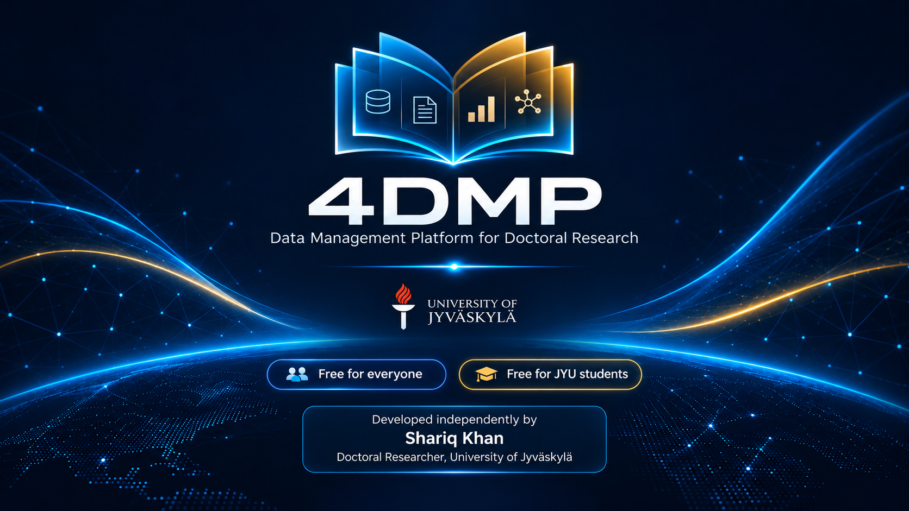

# 4DMP — Data Management Platform for Doctoral Research

**Your Research. Your Data. Your Plan.**

Developed independently by **Shariq Khan**, Doctoral Researcher at the University of Jyväskylä.

4DMP is a free Windows desktop application for doctoral research data management, reference management, and research organization.

The application is independently developed and is not an official University of Jyväskylä application.
